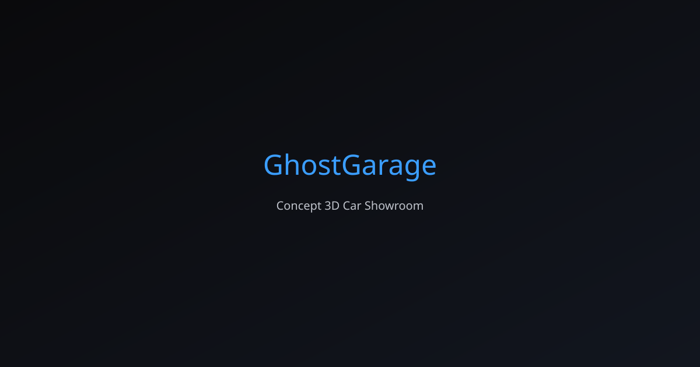

# GhostGarage

Premium browser-based **3D concept car customizer** — a personal portfolio project built with React 19, Three.js, and React Three Fiber.

> All vehicles, prices, and performance figures are **fictional**. This is not a commercial vehicle configurator and is not affiliated with any manufacturer.



## Features

- [x] Interactive 3D showroom with reflections, shadows, and orbit controls
- [x] Three distinct procedural concept vehicles (Ghost GT / R / X)
- [x] Exterior paint (8 colors × gloss / matte / metallic)
- [x] Wheel styles, finishes, and sizes with visible geometry changes
- [x] Body kits, splitter, diffuser, skirts, spoiler, carbon roof
- [x] Headlights / taillights and day / night / studio lighting
- [x] Performance packages with simulated specs and pricing
- [x] Malaysian Ringgit fictional pricing engine
- [x] Save / load / rename / duplicate / delete / compare builds (localStorage)
- [x] Shareable configuration URLs
- [x] Screenshot export (PNG)
- [x] Camera presets, auto-rotate turntable, undo/redo, keyboard shortcuts
- [x] Responsive desktop / tablet / mobile layouts
- [x] Vitest unit tests + Playwright smoke test

## Tech stack

- React 19 + TypeScript + Vite
- Tailwind CSS v4
- Three.js + React Three Fiber + Drei
- Zustand
- Framer Motion
- Lucide React
- Vitest + React Testing Library + Playwright

## Quick start (Windows PowerShell)

```powershell
cd C:\Users\sd01\Projects\ghostgarage
npm install
npm run dev
```

Open the URL printed by Vite (usually `http://localhost:5173`).

### Tests

```powershell
npm test
npm run test:e2e:install   # first time only
npm run test:e2e
```

### Production build

```powershell
npm run build
npm run preview
```

## Project structure

```
src/
  components/   # layout, configurator, UI
  three/        # vehicles, lighting, camera, showroom
  store/        # Zustand state
  data/         # vehicles, paints, wheels, pricing
  utils/        # pricing, share URLs, storage
  hooks/
  tests/
public/
docs/
e2e/
```

## Asset licensing

See [ASSETS.md](./ASSETS.md). Source code is MIT — see [LICENSE](./LICENSE).

## Screenshots

Add captures from the in-app **Shot** button to `docs/` and link them here.

## Disclaimer

GhostGarage is a portfolio demonstration. Prices shown in MYR are simulated estimates only and must not be treated as real vehicle quotations.
